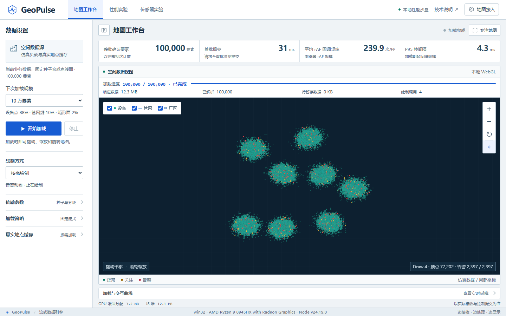

# GeoPulse

面向园区点、线和区域数据的流式 WebGL 地图原型。HTTP NDJSON 持续读取，Worker 按批解析，主线程分段写入，上传确认后才继续下一批。默认固定2048条批次和按需绘制；本地沙盒可直接运行，百度底图需要自己的浏览器端AK。



截图来自无账号、无外网的本地沙盒冷启动验证；其中 rAF 回调指标不等同于屏幕呈现帧率。

## 开始运行

安装 Node.js 20 或更新版本，然后在仓库根目录运行：

```sh
npm start
```

打开 http://127.0.0.1:4173/ 。应用无需安装npm依赖。Windows也可双击 `start.cmd`。首次先用本地沙盒，不需要地图账号；若连接百度，在“地图接入”填入自己的浏览器端AK并配置来源白名单，不要提交AK到仓库。

点击开始加载，可切换点/线/区域图层、平移缩放、查看告警与运行记录；支持停止后重新加载。导出按钮把报告保存在本机 `reports`，该目录默认不进入Git。

## 实现要点

- **持续取流与背压**：按当前批次剩余容量解析；完整批上传确认后发送ACK，一次只允许一个未确认批次。ACK不是GPU执行完成或屏幕呈现。
- **增量更新**：同ID的连续顶点绑定合并脏范围，避免重复全页统计；可选简要提交回执。位置更新作用于当前绑定槽位，后续同ID追加保留新输入坐标。
- **空间拾取**：复用完整空间树缩小候选，再计算精确最近顶点；树未完成时回退全扫描。移动对象、删除与透明状态单独处理。
- **按需绘制**：数据、交互、动画与建树工作驱动绘制。告警脉冲等活动存在时仍会绘制，不能把demand理解为永远零帧。
- **可核对实验**：位置、上传、候选、图元完整性、失败状态及实际导出分别验证；保留负结果，不将局部CPU提速换算为整张地图FPS。

动态包围盒维护与“首批2048、后续8192”目前是研究候选，没有替换正式默认。本轮五组合比较包含246项质量断言、72次完整RGBA对照，以及54次性能加载；材料、采用状态和负结果见[测试报告](docs/TEST-REPORT.md)。

## 测试与复现

```sh
npm test
```

默认执行仓库包含的核心Node测试，不需要AK、浏览器或外部服务。2026年10月14日在此公开副本实跑 **594/594通过，0失败、0跳过**；重新执行时以当次输出为准。不要把历史完整研究中的612项等同于本精简仓库的默认测试数。

需要验证真实取流、Worker、完整图元上传、像素、更新、取消和导出时，按[可选浏览器复现](docs/BROWSER-REPRODUCTION.md)运行独立链路工具。它不包含在默认CI中，研究组合也没有改写生产默认。

一个依赖约69.23MiB历史JSON的归档证据审计测试被单列为 `npm run test:archive`。历史报告原件没有复制到公开仓库；缺少输入时该命令明确退出2，不静默跳过。详情见[归档测试](docs/ARCHIVE-TESTS.md)。GitHub Actions只运行核心Node测试，不能替代原生WebGL、真实SDK或性能测试。

## 当前边界

百万压力材料是固定种子合成点、折线与轴对齐矩形，不是真实百万设备。当前未支持任意凹多边形、孔洞和完整GeoJSON编辑；线/面的点击仍采用最近顶点语义。

真实百度SDK强制context loss曾触发整页reload，原地图实例恢复未证实；普通加载通过不能覆盖这个失败。神经网络演示保留误报和负收益结果，不是可靠工业告警系统。详见[已知限制](docs/KNOWN-LIMITATIONS.md)。

## 许可证与来源

自有源码采用[MIT](LICENSE)。SKAB数据及其重排文件有单独GPL-3.0文本和作者说明，不受项目MIT声明替代。见[第三方材料](THIRD_PARTY_NOTICES.md)与[模型实验](ml/README.md)。百度SDK在线加载，用户自行配置服务账号。

拟发布到 GitHub `Lin-lab-ooo/GeoPulse`，并同步 Gitee 国内镜像；当前材料准备完成不等于远程仓库已创建或已推送。实际远程链接和发布 tag 在成功发布后补入。
