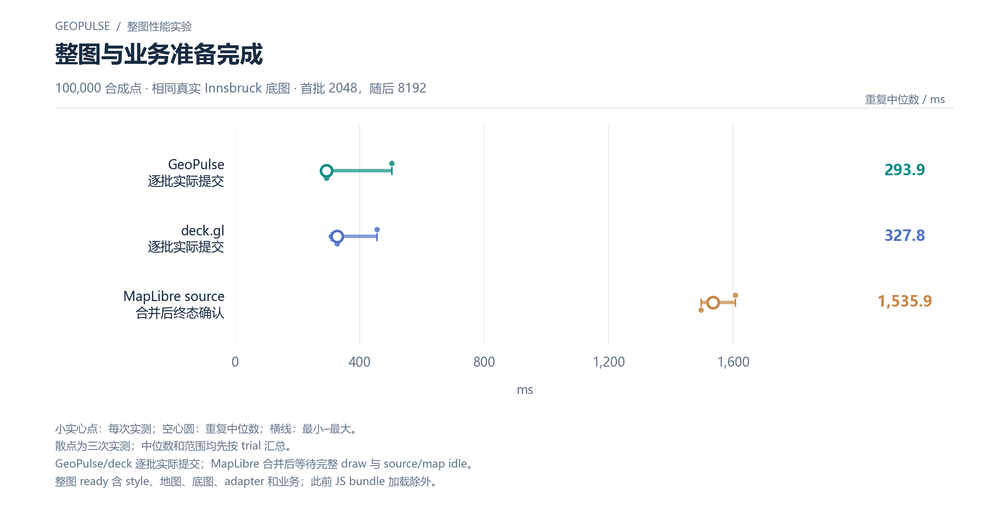

# GeoPulse

面向园区点、线和区域数据的流式 WebGL 地图原型。HTTP NDJSON 持续读取，Worker 按批解析，主线程分段写入，上传确认后才继续下一批。默认固定2048条批次和按需绘制；本地沙盒可直接运行，百度底图需要自己的浏览器端AK。


截图来自无账号、无外网的本地沙盒冷启动验证；其中 rAF 回调指标不等同于屏幕呈现帧率。

## 开始运行

安装 Node.js 20 或更新版本，然后在仓库根目录运行：

```sh
npm start
```

打开 http://127.0.0.1:4173/ 。应用无需安装npm依赖。Windows也可双击 `start.cmd`。首次先用本地沙盒，不需要地图账号；若连接百度，在“地图接入”填入自己的浏览器端AK并配置来源白名单，不要提交AK到仓库。

点击开始加载，可切换点/线/区域图层、平移缩放、查看告警与运行记录；支持停止后重新加载。导出按钮把报告保存在本机 `reports`，该目录默认不进入Git。

## 实现要点

- **持续取流与背压**：按当前批次剩余容量解析；完整批上传确认后发送ACK，一次只允许一个未确认批次。ACK不是GPU执行完成或屏幕呈现。
- **增量更新**：同ID的连续顶点绑定合并脏范围，避免重复全页统计；可选简要提交回执。位置更新作用于当前绑定槽位，后续同ID追加保留新输入坐标。
- **空间拾取**：复用完整空间树缩小候选，再计算精确最近顶点；树未完成时回退全扫描。移动对象、删除与透明状态单独处理。
- **按需绘制**：数据、交互、动画与建树工作驱动绘制。告警脉冲等活动存在时仍会绘制，不能把demand理解为永远零帧。
- **可核对实验**：位置、上传、候选、图元完整性、失败状态及实际导出分别验证；保留负结果，不将局部CPU提速换算为整张地图FPS。

动态包围盒维护与“首批2048、后续8192”目前是研究候选，没有替换正式默认。本轮五组合比较包含246项质量断言、72次完整RGBA对照，以及54次性能加载；材料、采用状态和负结果见[测试报告](docs/TEST-REPORT.md)。

## 整图性能报告与曲线

[按主题阅读新版性能图](reports/whole-map-2026-10-15-design/README.md)：每张图单独展示一个主题，保留实测散点、中位数与范围；加载、更新、CPU、GPU 和百度验证分别组织。下载仓库后可打开其中的 `index.html`，一次浏览一张图。本次只是图表重排，原始数据和报告保留。

[2026-10-14 整图报告](reports/whole-map-2026-10-14/README.md)比较真实城市底图上的流式加载、地图交互和位置更新，分别记录 CPU、GPU 与浏览器呈现反馈。下表为本机 10 万合成点、相同批量策略、各三次重复的中位数；MapLibre 使用原生更新合并。各库的完成条件和重复范围在报告中单列。

| 指标 | GeoPulse | deck.gl | MapLibre |
| --- | ---: | ---: | ---: |
| 底图＋业务准备完成 | 293.9 ms | 327.8 ms | 1535.9 ms |
| 两点位置更新至实际绘制确认 | 3.7 ms | 4.2 ms | 504.3 ms |

准备时间包含底图资源与业务链路，排除运行前已加载的 JS 包。优势集中在这些场景的数据接入和位置更新；整图稳态 GPU 绘制没有 GeoPulse 领先证据，不能把加载收益换算为 FPS 提升。与 deck.gl 的准备时间重复范围存在重叠，不据中位数小差异宣称普遍优势。



[单独查看两点更新图](reports/whole-map-2026-10-15-design/charts/updates/two-point-update-wall.md) · [单独查看整图 CPU](reports/whole-map-2026-10-15-design/charts/matched/camera-whole-map-cpu.md) · [单独查看整图 GPU](reports/whole-map-2026-10-15-design/charts/matched/camera-whole-map-gpu.md)。

百度生产路径另测真实上海底图上的 10 万合成点、线、矩形（12 万顶点）。底图准备后的业务加载中位数由 454.3 ms 降到 254.3 ms；SDK 连接和底图网络准备时间另记。这是固定批次与 hybrid 的本机对照，不能当作整张地图冷启动或帧率提升。

本版默认百度接入使用 SDK 标准底图，避免可选自定义样式加载失败时出现空白底图。今后的主要性能结论遵循[整图测试协议](docs/WHOLE-MAP-BENCHMARK-PROTOCOL.md)：先验证底图有效，再测完整链路，保留缺失值、失败和不同确认合同。

## 测试与复现

```sh
npm test
```

默认执行仓库包含的核心Node测试，不需要AK、浏览器或外部服务。2026年10月14日在此公开副本实跑 **594/594通过，0失败、0跳过**；重新执行时以当次输出为准。不要把历史完整研究中的612项等同于本精简仓库的默认测试数。

本次上传前再次执行核心测试，仍为 **594/594 通过**。本次测试回执、源码身份与测量证据范围见[发布核验记录](docs/WHOLE-MAP-PUBLICATION-CHECKS.json)。

图表源码和从公开聚合数据重画的命令见[图表复现](tools/whole-map-report-analysis/README.md)，不需要地图 AK。

新版独立图与画廊的生成命令见[新版图表复现](tools/whole-map-report-design/README.md)。

需要验证真实取流、Worker、完整图元上传、像素、更新、取消和导出时，按[可选浏览器复现](docs/BROWSER-REPRODUCTION.md)运行独立链路工具。它不包含在默认CI中，研究组合也没有改写生产默认。

一个依赖约69.23MiB历史JSON的归档证据审计测试被单列为 `npm run test:archive`。历史报告原件没有复制到公开仓库；缺少输入时该命令明确退出2，不静默跳过。详情见[归档测试](docs/ARCHIVE-TESTS.md)。GitHub Actions只运行核心Node测试，不能替代原生WebGL、真实SDK或性能测试。

## 当前边界

百万压力材料是固定种子合成点、折线与轴对齐矩形，不是真实百万设备。当前未支持任意凹多边形、孔洞和完整GeoJSON编辑；线/面的点击仍采用最近顶点语义。

真实百度SDK强制context loss曾触发整页reload，原地图实例恢复未证实；普通加载通过不能覆盖这个失败。神经网络演示保留误报和负收益结果，不是可靠工业告警系统。详见[已知限制](docs/KNOWN-LIMITATIONS.md)。

## 许可证与来源

自有源码采用[MIT](LICENSE)。SKAB数据及其重排文件有单独GPL-3.0文本和作者说明，不受项目MIT声明替代。见[第三方材料](THIRD_PARTY_NOTICES.md)与[模型实验](ml/README.md)。百度SDK在线加载，用户自行配置服务账号。

GitHub：[Lin-lab-ooo/GeoPulse](https://github.com/Lin-lab-ooo/GeoPulse) · Gitee：[lin-lab/GeoPulse](https://gitee.com/lin-lab/GeoPulse)。两边使用同一条发布历史；历史创建时点清单保留原始状态，不作为当前发布状态。
