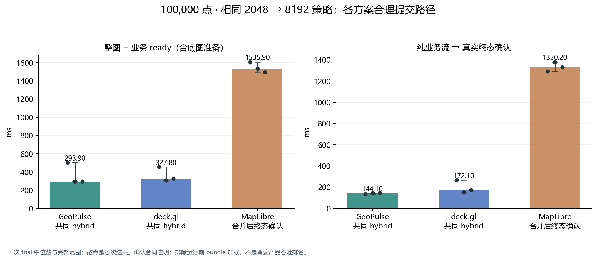
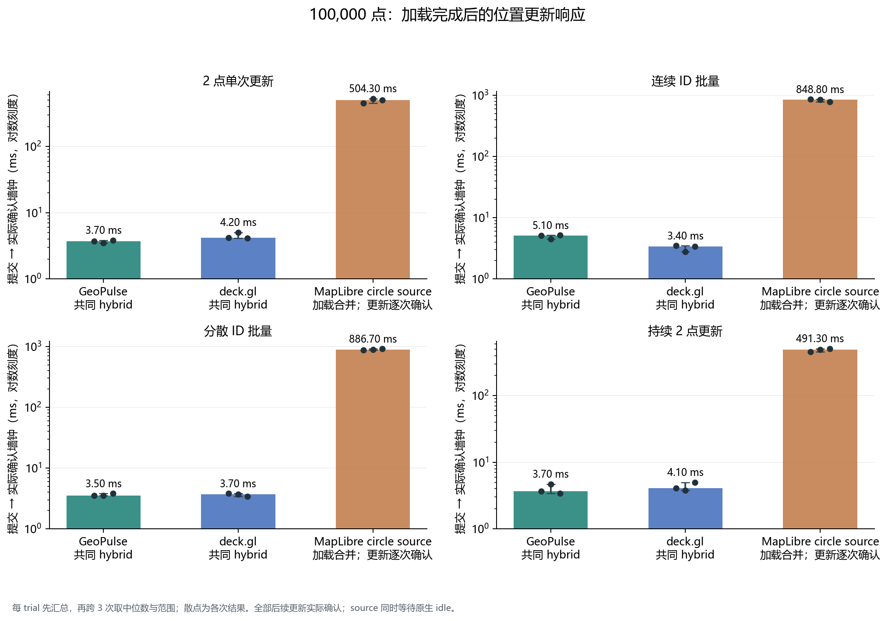
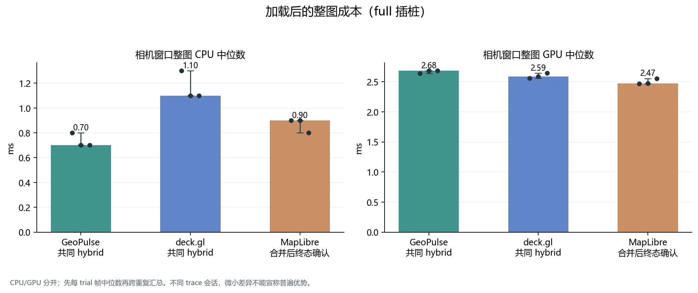
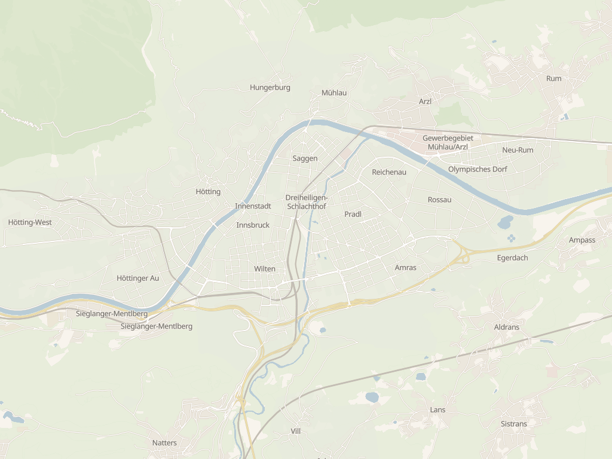
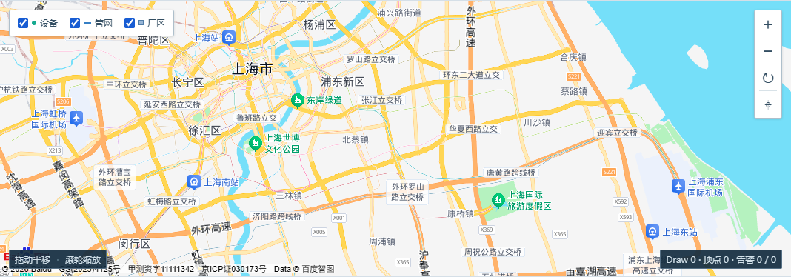

# GeoPulse 整张地图性能报告 · 2026-10-14

这份报告使用真实地理底图、业务流、相机运动和实际位置更新。主要对照在同一固定 Innsbruck 矢量底图与 MapLibre GL JS 6.14.0 上比较 GeoPulse、deck.gl 9.4.0 和 MapLibre 原生 source；真实百度生产应用单独验证。业务输入为合成要素，计时、批次、绘制和截图均来自实际运行。

每个条件运行 3 次。先汇总每 trial，再跨重复取中位数；括号是三次的最小–最大，不是置信区间。原始字节 SHA、公开衍生 JSON SHA 和图文件 SHA 分别记录，物理屏幕 FPS 始终为 `null`。

## 10 万点：共同批次与实际终态

共同策略为首批 2048、后续 8192，实际最大批次均核为 8192。GeoPulse / deck.gl 逐批实际提交；MapLibre 使用原生合并更新，并等待全部 promise、source/map idle、可见瓦片以及完整 100,000 点的实际 draw。

| 方案与完成合同 | 整图 + 业务 ready ms | 纯业务流 ms | 首实际业务确认 ms |
| --- | ---: | ---: | ---: |
| GeoPulse，逐批提交 | 293.90 (293.60–502.60) | 144.10 (132.90–145.00) | 26.90 (25.90–28.90) |
| deck.gl，逐批提交 | 327.80 (308.50–455.30) | 172.10 (153.40–267.40) | 45.10 (43.80–143.30) |
| MapLibre，合并后终态确认 | 1535.90 (1497.10–1606.40) | 1330.20 (1291.40–1378.00) | 65.10 (63.20–81.10) |

整图 ready 从 `load-real-basemap` mark 到 streaming window 结束，包含 style 获取、地图初始化、底图资源 ready、adapter 与业务流；运行前已经加载的 JS bundle 除外。合并臂的逐批 ACK 只表示入队，未当作 draw ACK、首屏或终态。完整方法和合同对照见 [matched 报告](matched.zh-CN.md)。

[SVG](figures/matched/matched-optimized-overview.svg) · [原始精度的公开聚合](data/matched.json)

## 已加载整图的位置更新

三个方案更新相同的 2 ID 与 2048 ID，并等待实际 commit/draw；原生 source 还等待 source/tile idle。GeoPulse / deck.gl 的 staging 回执与后续实际 draw revision 对账。

| 方案 | 2 点单次 ms | 连续 2048 ID ms | 分散 2048 ID ms |
| --- | ---: | ---: | ---: |
| GeoPulse | 3.70 (3.50–3.80) | 5.10 (4.50–5.20) | 3.50 (3.50–3.80) |
| deck.gl | 4.20 (4.10–5.00) | 3.40 (2.80–3.50) | 3.70 (3.40–3.80) |
| MapLibre source | 504.30 (451.20–525.30) | 848.80 (786.30–864.70) | 886.70 (866.20–912.00) |

这些结果支持此场景的加载/位置更新路径差异。严格确认与 source idle 的门槛不同，不能泛化为所有原生产品的固有更新延迟。持续更新有每次完成后 100ms 等待，其完成批次/秒只是这个节流场景的吞吐，不能改称产品最大刷新率或显示 FPS。

[SVG](figures/updates/matched-position-update-wall.svg) · [更新详情](updates.zh-CN.md) · [聚合](data/updates.json)

## 相机整图 CPU / GPU

| 方案 | 整图 render CPU ms/帧 | 共享地图 GL GPU ms/帧 |
| --- | ---: | ---: |
| GeoPulse | 0.700 (0.700–0.800) | 2.681 (2.636–2.682) |
| deck.gl | 1.100 (1.100–1.300) | 2.587 (2.557–2.644) |
| MapLibre 合并路径 | 0.900 (0.800–0.900) | 2.470 (2.465–2.555) |

CPU 是原生 callback 的同步服务区间；GPU 是共享地图 GL context 的异步 query span，排除 compositor。CPU 与 GPU 并行，不能相加成帧时延。这里没有 GeoPulse 整图 GPU 或物理帧率领先的结论；3 次重复和细小差异不足以推导普遍优胜。浏览器呈现反馈、rAF callback 节奏与物理 scanout 分开报告。

[SVG](figures/matched/matched-steady-camera.svg)

## 真实百度生产验证

标准百度 JSAPI 4.0 底图先通过空业务地理场景验证，再执行当前生产 UI 和 Worker → parser/packing → queue/ACK → main staging → GL 提交链路。业务为 100,000 合成要素：88,000 点、10,000 双顶点线、2,000 六顶点矩形，共 120,000 顶点；两方案同 seed 的几何 digest 完全相同，LOD=1。

| 方案 | 已 ready 底图后的业务流完成 ms | 首非空业务 GL 提交 ms | 每 trial 批次数 |
| --- | ---: | ---: | ---: |
| current | 454.30 (406.10–455.60) | 46.20 (45.90–49.70) | [49, 49, 49] |
| hybrid | 254.30 (242.30–277.10) | 45.80 (41.40–49.30) | [13, 13, 13] |

SDK 连接的单次墙钟为 7.199s，随后空业务底图 scene gate 为 26.642s，分别记录。上表是预先 ready 底图后的业务流，不能称整张地图冷启动。SDK/UI/地图复用，current-r0 是 SDK ready 后第一个业务 run，三次重复按方案轮换。

相机窗口 4419/4419 callback 有经过覆盖验证的 GL GPU 样本；loading 窗口仅 695/750 有效，55 个未验证 callback 保持 `null`。loading GPU 中位数只描述有效子集。DOM/2D labels/compositor 与 callback 外的命令不在共享 GL query 内，百度私有瓦片/布局子阶段没有独立 CPU 计量。

[SVG](figures/baidu/baidu-stream-and-startup.svg) · [百度完整报告](baidu.zh-CN.md) · [聚合](data/baidu.json)

初始 tile gate 实际记录 requested=10、failed=2、成功完成=8、inflight=0、quiet≈2343ms；整次 run 的 `requestFailures=3` 另列，`run.errors=0` 不代表没有网络失败。旧私有分析文字曾误写 failed=0，这里已按原 raw/data 勘误。`LocalSearch=0`，未触发百度 POI/place search。

百度使用不同 SDK、混合几何、投影与 canvas 面积（1068×373，viewport 1366×768 / DPR1），不能与共同 Innsbruck fixture（1024×768 / DPR1）跨平台排名。

## 空业务底图与质量证据

© OpenMapTiles © OpenStreetMap contributors；[底图归属与许可](ATTRIBUTION.md)。

地图/数据归属保留截图中的百度原标识；[说明](ATTRIBUTION.md)。

截图含可识别道路/河流/地点标签。Innsbruck 另保存完整解码的 25 矢量瓦片层计数和资源采集 HTTP response/body SHA；building 在 z13/z14 的瓦片与固定 style 中，概览截图不能单独证明所有高 zoom 建筑。百度截图含上海市、区名、道路和机场/车站标签，评分前业务顶点为 0。资源与视觉两类证据见 [basemap-validation.json](data/basemap-validation.json)。共同地图 runner未记录 browser requestfailed，该网络失败计数为 null；server missingAssets为空、pageerrors为0不能代替网络失败统计。

数量、实际位置更新、projection、完整几何、共享 context、LOD 与 witness 均随 trial 保留。有限 witness/位置核查不等于不同 shader 全图逐像素等价证明。

## 阅读与复核

- [主要共同批次与 native coalescing](matched.zh-CN.md)：优先用于批量路径对照。
- [相同位置更新](updates.zh-CN.md)：已加载整图上的 actual commit。
- [默认批次/严格逐批确认](primary.zh-CN.md)：完整历史实验，保留 20k/100k、纯底图参考与各阶段图。其原生约 13.3s 业务流来自严格逐批 render/idle 合同，不能当作 MapLibre 产品固有最大吞吐。
- [真实百度生产验证](baidu.zh-CN.md)：完整 callback、verified GL、呈现与阶段边界。
- [方法与时钟](methodology.zh-CN.md)、[排除/失败附录](excluded-cases.zh-CN.md)、[运行环境](data/environment.json)。
- [聚合 CSV](data/aggregate-metrics.csv) 含每 trial 数值、重复中位数/范围和 `null`；[来源 SHA 索引](source-index.json) 绑定原始输入与原图；[本报告文件清单](manifest.report-files.json) 绑定公开副本。
- [数值原证据目录](measurements/) 提供帧/批次/span/window/update/呈现点的独立提取，支持复算；完整多 GB CDP trace、SDK bundle 与私有原始应用档案未包含。

图表全部由实测输入聚合生成；公开版本逐字节复制 22 PNG + 22 SVG，不重绘数据或生成模拟计时。完整原始本地报告不覆盖，新增日期目录保留历史。结论限定于本机、固定 fixture、质量与明确完成合同，没有功耗、总 GPU 利用率或物理 FPS 结论。
