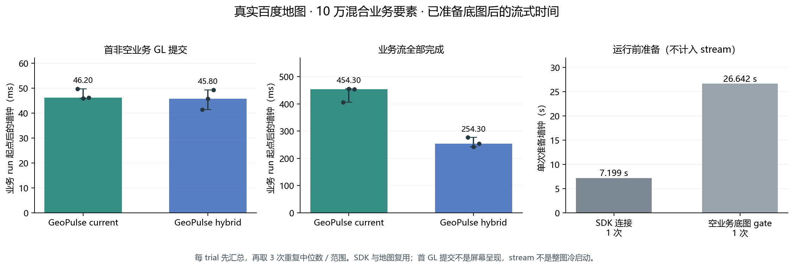
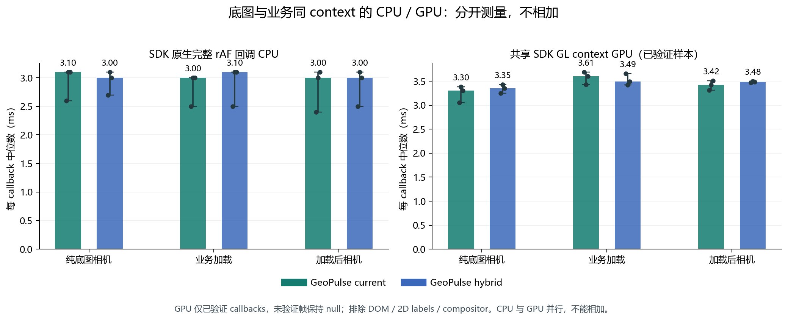
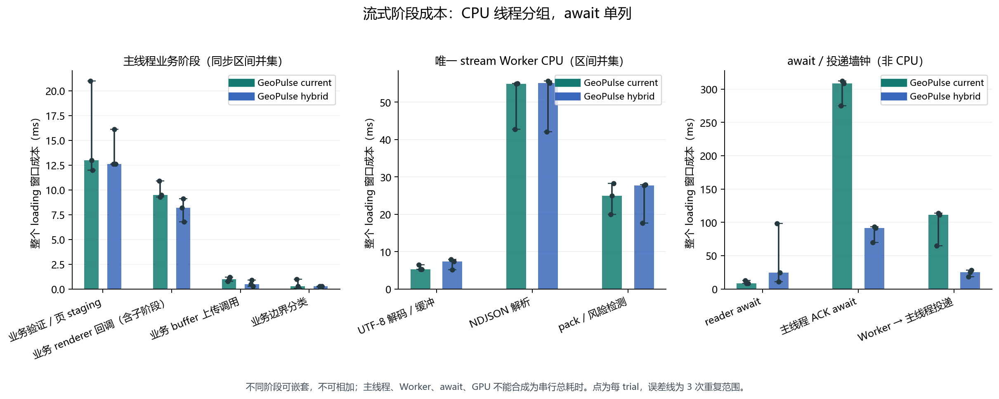
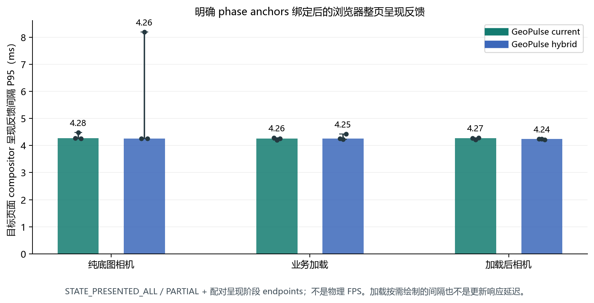

# 真实百度整图生产验证（公开衍生副本）

使用本输入报告的 6 条正式 trial。上海道路、区名、地点标签的空业务地图截图已目视核查；当前生产 renderer 未使用私有样式覆盖。旧 baidu-mixed1 的空白底图结果排除。
每条先汇总，再跨 3 次重复取中位数；括号是重复最小–最大，不是置信区间。单个 SDK / UI / 地图复用，执行顺序按重复轮换。current-r0 是 SDK ready 后首个业务 run，不是每次新建 SDK 的冷启动。

## 已准备底图后的业务流

| 方案 | 首非空业务 GL 提交 ms | 全业务完成 ms | batch 次数 |
| --- | ---: | ---: | ---: |
| GeoPulse current | 46.20（45.90–49.70） | 454.30（406.10–455.60） | [49, 49, 49] |
| GeoPulse hybrid | 45.80（41.40–49.30） | 254.30（242.30–277.10） | [13, 13, 13] |

业务是 100,000 条合成要素：88,000 点、10,000 双顶点线、2,000 六顶点矩形，共 120,000 顶点；同 seed 下两方案 CPU 几何 digest 完全一致。生产 Worker fetch → decode → parse → pack/detect → ACK/backpressure → main staging → GL 提交链路保持一致，hybrid 改变批量策略。
首可见字段实际定义为非空业务 GL draw 提交，不代表 GPU 完成或屏幕呈现。全部完成字段包括全部批次提交后的 ACK；不含预先完成的 SDK / 底图准备。
运行前单次 SDK 连接 7.199s，随后空业务底图 scene gate 26.642s，分开记录，不能把业务 stream 当作整张地图冷启动。SDK load retry=0。

## 完整 SDK callback CPU 与共享 GL GPU

| 场景 | 方案 | callback CPU 中位 ms | callback CPU P95 ms | verified GL GPU 中位 ms | verified GL GPU P95 ms | GPU 样本 / callbacks |
| --- | --- | ---: | ---: | ---: | ---: | --- |
| baseline | GeoPulse current | 3.10（2.60–3.10） | 3.80（3.70–3.80） | 3.30（3.05–3.38） | 4.11（3.95–4.18） | [480, 466, 471] / [480, 466, 471] |
| baseline | GeoPulse hybrid | 3.00（2.70–3.10） | 3.80（3.60–3.80） | 3.35（3.25–3.43） | 4.12（4.07–4.25） | [477, 463, 476] / [477, 463, 476] |
| loading | GeoPulse current | 3.00（2.50–3.00） | 3.50（3.45–3.80） | 3.61（3.43–3.69） | 4.09（3.79–4.19） | [121, 126, 150] / [131, 135, 159] |
| loading | GeoPulse hybrid | 3.10（2.50–3.10） | 3.90（3.45–3.98） | 3.49（3.42–3.66） | 4.12（4.10–4.19） | [103, 97, 98] / [111, 106, 108] |
| camera | GeoPulse current | 3.00（2.40–3.10） | 3.70（3.20–3.90） | 3.42（3.31–3.51） | 4.24（3.95–4.38） | [743, 737, 727] / [743, 737, 727] |
| camera | GeoPulse hybrid | 3.00（2.50–3.10） | 3.70（3.40–3.80） | 3.48（3.47–3.50） | 4.12（4.10–4.39） | [744, 727, 741] / [744, 727, 741] |

CPU 覆盖 observer 判定为 SDK 原生 rAF callback 的完整同步函数区间，包含底图、业务及嵌套观察工作；stack domain 是归属启发式，不是原生内部精确分段。SDK 私有瓦片解码 / 布局 / 单图层 CPU 未独立插桩，不能从完整 callback 倒推这些阶段。
有效 GPU 覆盖共享百度 GL context 从首次观察到的 render/upload 命令到 callback 返回；底图命令在业务 render 之外、业务命令在 render 之内，并要求同 callback。DOM、2D labels、compositor 和 callback 外命令不在计时内。它是经过覆盖核查的地图 GL 工作，不是浏览器所有 GPU 工作。
每窗口仅使用 coverageVerified 的 wholeMapGpuMs；targetContextGpuMs 不能替代整图。standard1 六个 loading 记录 otherContext draw 32 次，但 contextId=4 与 targetContextId=4 相同。只读源码核查表明 reset 暂把 renderer._gl 置 null，首个 SDK callback 的底图前缀因此被误归为 other 且未被 query 完整包住；旧 observer 保守将整窗口失效。这是 reset 边界归类 / 覆盖缺口，不是 SDK 实际多 context。旧 raw 保持 null，修正后的新输入若 coverageVerified 则按实测汇总。
业务加载窗口含开始/完成控制、末尾 100ms 等待；它的 callback 分布不是纯 stream duration 分布。complete1 loading 仍有前数据期 / 尚未满足业务 draw 条件的未验证 callback，GPU 中位数仅针对 verified 子集，不是全部加载窗口 GPU 总耗时。

## 阶段与时钟边界

阶段图使用同一阶段 / 同线程同步 span 区间并集；SDK callback 与业务子阶段嵌套，不能相加。主线程全部已观察同步工作做并集，唯一 stream Worker CPU 另做并集，await 与 transport 墙钟单列。不同线程不能加成 wall time。
| 方案 | loading 主线程已观察同步并集 ms | 唯一 stream Worker CPU 并集 ms | 原生 callback 间隔 P95 ms（loaded camera） |
| --- | ---: | ---: | ---: |
| GeoPulse current | 424.10（365.50–485.10） | 85.30（69.40–88.70） | 4.30（4.30–4.30） |
| GeoPulse hybrid | 351.20（302.40–352.10） | 88.70（67.90–90.40） | 4.30（4.30–4.30） |

## 目标网页 compositor 呈现反馈

| 场景 | 方案 | feedback 间隔 P50 ms | feedback 间隔 P95 ms | 每 trial 反馈点数 |
| --- | --- | ---: | ---: | --- |
| baseline | GeoPulse current | 4.17（4.17–4.17） | 4.28（4.26–4.48） | [473, 459, 467] |
| baseline | GeoPulse hybrid | 4.17（4.17–4.17） | 4.26（4.26–8.20） | [474, 454, 472] |
| loading | GeoPulse current | 4.17（4.17–4.17） | 4.26（4.20–4.29） | [129, 136, 157] |
| loading | GeoPulse hybrid | 4.17（4.16–4.17） | 4.25（4.23–4.43） | [111, 104, 107] |
| camera | GeoPulse current | 4.17（4.17–4.17） | 4.27（4.22–4.29） | [744, 731, 721] |
| camera | GeoPulse hybrid | 4.17（4.17–4.17） | 4.24（4.22–4.25） | [742, 723, 738] |

wm-baidu-* authored marks 绑定唯一 target renderer，并用 begin/end browser epoch anchors 映射 trace monotonic ts；至少2锚点、残差≤2ms才按 origin+phaseMs 精确切窗。只计 PipelineReporter PRESENTED_ALL/PARTIAL 与配对呈现阶段终点，按实际呈现时刻去重。PARTIAL 不证明每次业务 revision 完整显示。
Raw traces 逐条 SHA 验证后，流式提取原样 presentation pairs / marks / metadata 到小 evidence trace，再调用同一 trace analyzer。过滤 trace 排除 CPU X events，不能用于宣称整个浏览器 CPU；CPU 图仍是 observer 同线程区间并集。

浏览器 feedback 不是物理屏幕 scanout，physical FPS 始终 null。不将整个 trace（含 idle / 截图）换算成 FPS。rAF 间隔只描述 callback cadence。加载按需绘制的长间隔不直接等于卡顿或业务更新响应延迟。

## 场景与源码证据

原回执 sceneValid=True、protocolPassed=True；raw requestFailures=3；主业务 draw / 全顶点提交 / ACK / revisions / LOD=1 已复核。source/runtime before=after；48 项文件 SHA 匹配；renderer native/served SHA 相等；overflow=0、pending query=0、LocalSearch=0。
空业务预检 native draw=800，crop colors=739；成功完成 tile responses=8，inflight=0，安静 2343ms≥2000ms。原始 visualReview.verifiedRoadsAndPlaceLabels=false 是待人工核查占位，本分析另外记录已读截图的道路/地名证据，未修改 raw。
HTTP quiet gate 是评分前场景准备证据，不表示相机之后永远不再请求瓦片。最终 cleanup 的 tileNetworkFinal 不回写初始 gate，也不证明 tiles 语义完整。原 raw 的 requestFailures 另保留在 data/baidu.json，未有 trial 时间归属，不能声称全 run 没有网络失败；初始预检 requested tile=10、failed=2、成功完成=8、inflight=0。standard1 的历史四个 abort 亦不回写。
本次浏览器 viewport 为 1366×768 / DPR1，真实地图 canvas 为 1068×373。百度混合生产应用与 MapLibre/GeoPulse/deck 的共同点 fixture、投影、canvas 面积及 SDK 均不同，本报告用于生产平台全链验证，不能据此跨平台排名。重复数量小、仪表与 tracing 有开销，不推导产品最大 FPS 或普适速度倍数。

图形：baidu-stream-and-startup、baidu-native-callback-cpu-gpu、baidu-stream-phase-costs。完整可追溯聚合见 [data/baidu.json](data/baidu.json)。

公开副本勘误：旧分析文字曾误写初始 tile failed=0；原始 report/data 实际为 2，本副本按原值修正。整次运行另有 3 个 requestFailures，与 run.errors=0 是不同计数；这些失败不能据无 trial 归属而消失。旧 raw 与旧图均未改写。

## 可直接查看的原始分析图

[SVG](figures/baidu/baidu-stream-and-startup.svg)

[SVG](figures/baidu/baidu-native-callback-cpu-gpu.svg)

[SVG](figures/baidu/baidu-stream-phase-costs.svg)

[SVG](figures/baidu/baidu-compositor-feedback.svg)

聚合：[baidu.json](data/baidu.json)。来源索引：[source-index.json](source-index.json)。所有缺失值仍为 null；这份文字/JSON是公开衍生副本，原始 SHA 不等于改写文件 SHA。
