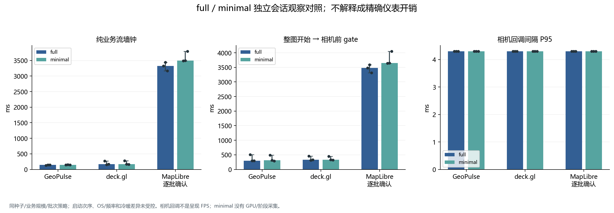
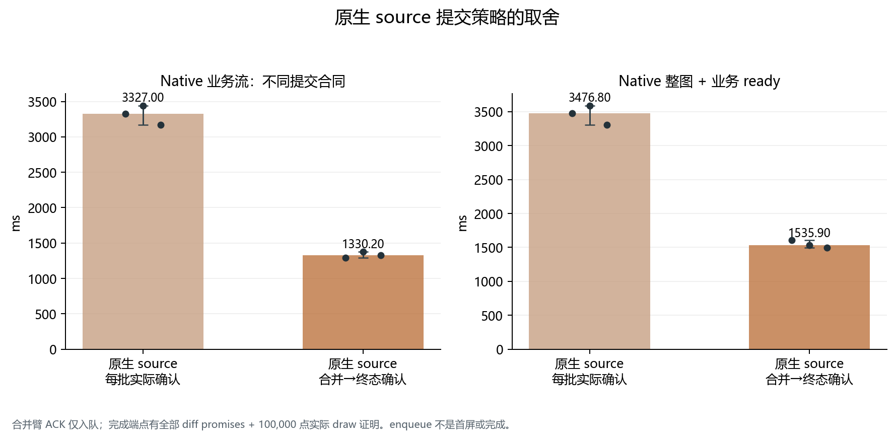

# 共同批次策略与合理原生提交：整图补充结果（公开衍生副本）

优先阅读本补充表：三个方案都采用首批 2048、随后 8192，实际最大批次均核为 8192。GeoPulse / deck 保留逐批实际提交，MapLibre 的合理合并臂以最终全部更新和真实完整绘制确认。
主测试 primary 保留原默认策略、逐批 render/idle ACK 的完整成本；它的 13 秒原生流结果不能泛化成产品固有吞吐，更不能用来宣布笼统数十倍优势。

## 100,000 点：同批次策略、明确终态合同

| 方案/合同 | 重复 | 整图 + 业务 ready ms | 纯业务流 ms | 首实际业务确认 ms |
| --- | ---: | ---: | ---: | ---: |
| GeoPulse；逐批提交 | 3 | 293.90 (293.60–502.60) | 144.10 (132.90–145.00) | 26.90 (25.90–28.90) |
| deck.gl；逐批提交 | 3 | 327.80 (308.50–455.30) | 172.10 (153.40–267.40) | 45.10 (43.80–143.30) |
| MapLibre；合并后实际终态确认 | 3 | 1535.90 (1497.10–1606.40) | 1330.20 (1291.40–1378.00) | 65.10 (63.20–81.10) |
| MapLibre；每批实际 render/idle 确认（合同对照） | 3 | 3476.80 (3308.00–3588.10) | 3327.00 (3166.80–3440.60) | 54.10 (53.40–62.00) |

括号是三次独立 trial 的最小–最大。整图 ready 是 load-real-basemap mark → streaming window 结束，包含 style/地图初始化、底图资源 ready、adapter 和业务处理；之前已加载的 JS bundle 除外。
原生合并臂的逐批 ACK 是 enqueue，未当作逐批完成或首屏。最终完成已核全部 native update promises、source/map idle、可见瓦片与已上传 circle buckets，以及最终非空 100,000 点绘制。首业务值来自实际 native circle GL submission 的 adapter 证明，仍不是物理显示时间。

## full / minimal：观察差异，不是精确仪表开销

| 方案 | full 流 ms | minimal 流 ms | full 整图开始→相机前 gate ms | minimal 同 gate ms | full 回调间隔 P95 ms | minimal 回调间隔 P95 ms |
| --- | ---: | ---: | ---: | ---: | ---: | ---: |
| GeoPulse 当前 | 144.10 (132.90–145.00) | 144.70 (141.60–149.90) | 297.20 (296.70–506.50) | 313.70 (291.90–491.00) | 4.300 (4.300–4.300) | 4.300 (4.300–4.300) |
| deck.gl | 172.10 (153.40–267.40) | 167.80 (161.80–280.60) | 332.30 (312.70–458.00) | 331.90 (326.50–447.60) | 4.300 (4.300–4.300) | 4.300 (4.300–4.300) |
| MapLibre source | 3327.00 (3166.80–3440.60) | 3497.10 (3492.30–3796.00) | 3480.30 (3312.10–3591.50) | 3644.70 (3639.90–4050.40) | 4.300 (4.300–4.300) | 4.300 (4.300–4.300) |

minimal 不记录细分 windows、GPU、native Worker profile 或 CDP trace；为比较整图墙钟，双方统一使用 load mark → camera phase mark，额外包含 streaming 后、相机开始前的 idle gate。它与上表的精确 stream-end 端点有区别，不虚构 minimal 的详细结束边界。
full 和 minimal 是不同启动会话，启动顺序、OS、频率与冷暖状态没有配对控制。deck 的首轮波动保留在散点与范围中，不能把两轮差值当作准确 observer CPU/GPU 开销或因果提升。
相机 pose 间隔是原生 rAF 驱动的相机命令回调节奏，不是整图呈现或物理屏幕 FPS。minimal 缺少 GPU 样本保持 null。

## 相机窗口整图 CPU / GPU

| 方案 | CPU ms/帧 | GPU ms/帧 |
| --- | ---: | ---: |
| GeoPulse | 0.700 (0.700–0.800) | 2.681 (2.636–2.682) |
| deck.gl | 1.100 (1.100–1.300) | 2.587 (2.557–2.644) |
| MapLibre 合并路径 | 0.900 (0.800–0.900) | 2.470 (2.465–2.555) |

CPU/GPU 分开呈现，不能相加成帧延迟；GPU 范围是共享地图 GL context，排除 compositor。只有三次重复，稳态差异不能据细小数值判普遍优胜。加载/更新路径优势不自动转成整图 GPU 或显示帧率优势。
本补充记录真实固定城市底图 + 合成点，有限 witness/位置校验不能提升为不同 shader 的全图像素等价证明。原始回执、trial SHA、实际 batch 与最终 draw 证明均保留在 data/matched.json。

## 可直接查看的原始分析图

[SVG](figures/matched/matched-optimized-overview.svg)

[SVG](figures/matched/instrumentation-observed-control.svg)

[SVG](figures/matched/matched-steady-camera.svg)

[SVG](figures/matched/native-contract-comparison.svg)

聚合：[matched.json](data/matched.json)。来源索引：[source-index.json](source-index.json)。所有缺失值仍为 null；这份文字/JSON是公开衍生副本，原始 SHA 不等于改写文件 SHA。
