# 整张地图性能结果（公开衍生副本）

本报告使用 27 条正式 trial，其中 27 条满足分析门禁；原运行 passed=True。未将 smoke/preflight 用于排名。
每 trial 先汇总，再跨重复取中位数；括号为重复最小–最大，不是置信区间。缺失保持 null，不以 0 代替。
同一份本地固定真实城市矢量底图，共享 MapLibre WebGL context，业务是合成点。各方案确认门槛不同：原生 source 等待 source/tile idle，其他臂确认实际业务上传/绘制。

## 整图与业务准备墙钟

整图 + 业务准备从 load-real-basemap mark 到 streaming window 结束，包含 style 获取、地图初始化、底图 ready、adapter 与业务流。运行前已经加载的 JS bundle 不在此端点内。纯业务 streamMs 单列。

| 规模 | 方案 | 重复 | 整图 + 业务 ready ms | 纯业务流 ms | 首完整批确认 ms |
| --- | --- | ---: | ---: | ---: | ---: |
| 20,000 | GeoPulse 当前 | 3 | 229.00 (217.20–231.30) | 68.00 (66.70–74.30) | 27.40 (25.90–29.70) |
| 20,000 | GeoPulse hybrid | 3 | 216.70 (211.00–220.90) | 56.10 (53.40–56.60) | 26.50 (25.10–27.20) |
| 20,000 | deck.gl | 3 | 271.10 (241.50–352.90) | 96.50 (84.20–184.50) | 51.30 (43.60–137.50) |
| 20,000 | MapLibre source | 3 | 828.70 (813.90–866.30) | 668.30 (657.50–694.80) | 61.80 (59.50–68.80) |
| 100,000 | GeoPulse 当前 | 3 | 408.40 (396.30–411.70) | 236.40 (235.50–240.50) | 28.30 (27.60–29.70) |
| 100,000 | GeoPulse hybrid | 3 | 315.90 (315.20–320.30) | 153.10 (144.00–155.60) | 27.40 (25.90–28.60) |
| 100,000 | deck.gl | 3 | 451.40 (418.20–454.00) | 278.90 (264.20–283.40) | 47.90 (46.40–49.10) |
| 100,000 | MapLibre source | 3 | 13467.70 (13344.00–13971.90) | 13304.80 (13195.40–13770.80) | 58.20 (57.50–68.50) |

## 相机操作的整图 CPU / GPU

每格为每 trial 的整图帧中位数，再跨重复汇总。CPU 包含该原生 callback 的底图/业务工作与嵌套观察开销；GPU 是同地图 context 的异步 query，排除 compositor GPU。CPU 与 GPU 并行，不能相加为帧延迟。

| 规模 | 方案 | 整图 render CPU ms/帧 | 整图 GPU ms/帧 | 呈现反馈间隔 P95 ms |
| --- | --- | ---: | ---: | ---: |
| 20,000 | 纯底图参考 | 0.700 (0.600–0.800) | 2.589 (2.533–2.644) | 4.224 (4.218–4.261) |
| 20,000 | GeoPulse 当前 | 0.800 (0.700–0.900) | 2.555 (2.480–2.560) | 4.232 (4.211–4.240) |
| 20,000 | GeoPulse hybrid | 0.800 (0.700–0.900) | 2.500 (2.462–2.537) | 4.229 (4.204–4.236) |
| 20,000 | deck.gl | 1.100 (1.100–1.200) | 2.499 (2.355–2.581) | 4.221 (4.209–4.239) |
| 20,000 | MapLibre source | 0.900 (0.800–0.900) | 2.511 (2.468–2.595) | 4.237 (4.219–4.256) |
| 100,000 | GeoPulse 当前 | 0.900 (0.800–0.900) | 2.578 (2.530–2.612) | 4.223 (4.220–4.227) |
| 100,000 | GeoPulse hybrid | 0.900 (0.800–0.900) | 2.595 (2.518–2.648) | 4.242 (4.241–4.275) |
| 100,000 | deck.gl | 1.300 (1.100–1.300) | 2.550 (2.503–2.570) | 4.239 (4.230–4.255) |
| 100,000 | MapLibre source | 0.900 (0.900–1.000) | 2.525 (2.486–2.545) | 4.237 (4.225–4.262) |

CPU/GPU 分图，分别展示中位数与 P95。纯底图只有一个规模标签的实测，用作共同底图参考，不假装处理过 10 万业务点。
呈现反馈按 profile.windows / phaseMarks 绑定的目标 renderer 精确切分，不用包含初始化、idle 和质量检查的全 run FPS。浏览器 feedback 仍不是物理屏幕 scanout。

## 更新操作

| 规模 | 方案 | 2 点单次 ms | 连续 ID bulk ms | 分散 ID bulk ms | 持续每次中位数 ms | 持续完成次数 |
| --- | --- | ---: | ---: | ---: | ---: | --- |
| 20,000 | GeoPulse 当前 | 4.10 (3.90–4.30) | 4.40 (4.00–5.40) | 3.10 (2.50–3.60) | 4.90 (4.60–5.00) | [15, 15, 14] |
| 20,000 | GeoPulse hybrid | 4.10 (3.70–4.40) | 5.00 (5.00–6.70) | 4.30 (3.30–10.00) | 4.30 (3.70–4.70) | [15, 15, 15] |
| 20,000 | deck.gl | 4.70 (4.20–5.30) | 2.90 (2.80–3.30) | 3.80 (2.50–4.30) | 4.00 (4.00–4.10) | [15, 15, 15] |
| 20,000 | MapLibre source | 91.10 (83.30–129.10) | 116.30 (111.70–132.60) | 127.50 (120.40–137.00) | 98.20 (82.80–98.25) | [8, 8, 8] |
| 100,000 | GeoPulse 当前 | 4.20 (4.20–4.30) | 4.20 (4.10–4.90) | 3.90 (2.90–4.80) | 4.10 (3.50–4.85) | [15, 14, 15] |
| 100,000 | GeoPulse hybrid | 4.00 (3.20–4.30) | 5.20 (4.10–5.50) | 4.00 (3.40–4.50) | 3.90 (3.90–4.80) | [15, 15, 15] |
| 100,000 | deck.gl | 4.00 (3.80–4.20) | 3.60 (3.00–8.30) | 3.00 (2.00–4.50) | 5.15 (3.40–5.30) | [15, 15, 14] |
| 100,000 | MapLibre source | 537.60 (495.60–641.60) | 795.50 (740.60–941.60) | 736.10 (732.10–857.60) | 543.60 (529.20–580.40) | [3, 3, 3] |

瞬时 bulk 的帧样本少，使用真实提交 → 确认墙钟及 CPU 区间，不用一两帧的分位数排名。持续更新固定时间内完成次数可能不同，实际次数已保留。

## 阶段计量与覆盖

主线程每阶段取同步区间并集。同一行避免重复计数，不同行仍有包含/交叠，不能相加。单个流 Worker 独立列出。两个原生 Worker 缺独立 workerId，只报单次同步调用中位数；tile parse 同步前缀是部分 CPU，不推算 Worker 总 CPU。
trace 的 tts/tdur 取线程时间区间并集；跨窗口边界事件排除，结果是被捕获工作的下界。线程 CPU、主线程服务区间、墙钟等待与 GPU 不相加。
独立静止相机窗口覆盖：未测：没有显式 stationary/static/steady window，不用 idle 空隙替代。
minimal 插桩若存在，仅比较其墙钟/计数；它没有 full 阶段或 GPU 数据，不当成 GPU 覆盖。

## 结论边界

数据描述本机、固定地图、给定操作及批次策略下的成本与取舍。只有三次重复，细小差异不能自动解释为统计显著或普遍优势。初始化/adapter/准备成本已单列，不用局部业务 draw/GPU 代替整图结论。
画质门禁含记录/位置校验、共享 context 与有限 witness 像素；不等于不同 shader 的全图逐像素等价证明。原始 trial/trace SHA 与每 trial 聚合保存在 [data/primary.json](data/primary.json)；原始 SHA 绑定未改写的本地档案，公开 JSON 是去除路径/URL后的衍生副本。

## 输出文件

- whole-map-ready-stream-wall.png
- whole-map-ready-stream-wall.svg
- whole-map-ack-progress.png
- whole-map-ack-progress.svg
- camera-whole-map-cpu.png
- camera-whole-map-cpu.svg
- camera-whole-map-gpu.png
- camera-whole-map-gpu.svg
- camera-compositor-feedback.png
- camera-compositor-feedback.svg
- continuous-updates-whole-map-cpu.png
- continuous-updates-whole-map-cpu.svg
- continuous-updates-whole-map-gpu.png
- continuous-updates-whole-map-gpu.svg
- update-confirmation-wall.png
- update-confirmation-wall.svg
- phase-streaming-main.png
- phase-streaming-main.svg
- phase-camera-main.png
- phase-camera-main.svg
- phase-streaming-stream-worker.png
- phase-streaming-stream-worker.svg
- phase-streaming-native-map-worker.png
- phase-streaming-native-map-worker.svg
- data/primary.json
- 逐 trial 窗口呈现统计保存在公开聚合中；完整 CDP trace 未包含，数值原证据另见 measurements/。

## 可直接查看的原始分析图

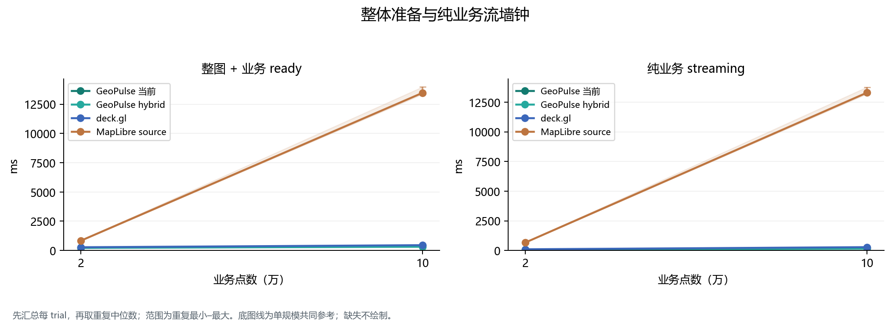

[SVG](figures/primary/whole-map-ready-stream-wall.svg)

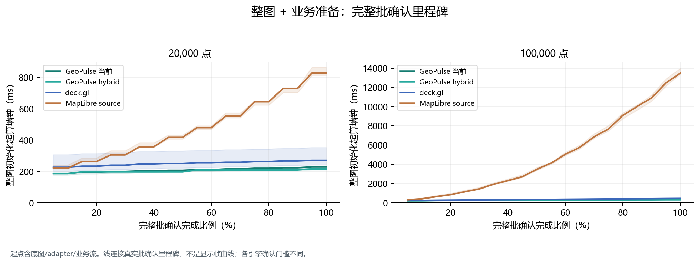

[SVG](figures/primary/whole-map-ack-progress.svg)

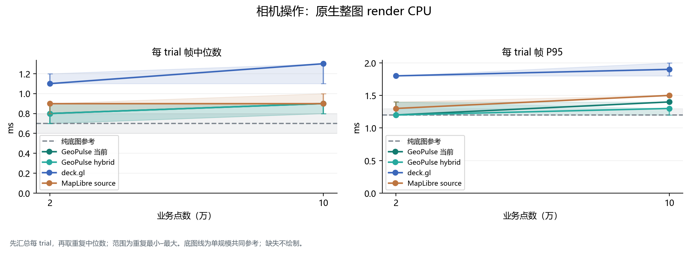

[SVG](figures/primary/camera-whole-map-cpu.svg)

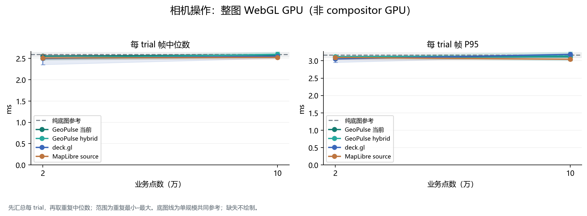

[SVG](figures/primary/camera-whole-map-gpu.svg)

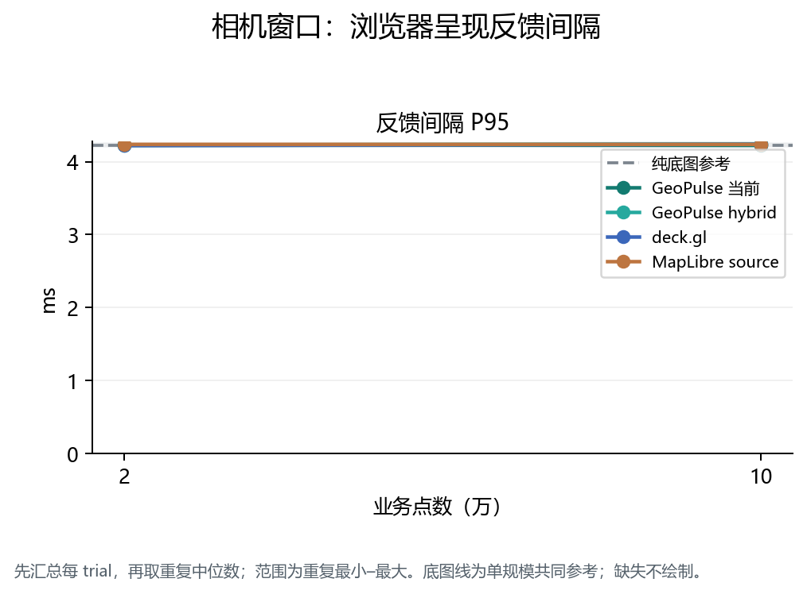

[SVG](figures/primary/camera-compositor-feedback.svg)

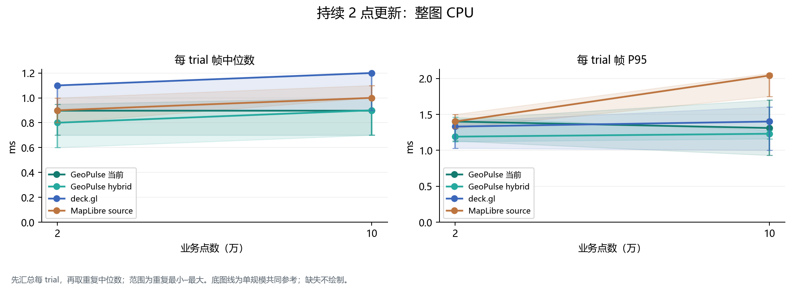

[SVG](figures/primary/continuous-updates-whole-map-cpu.svg)

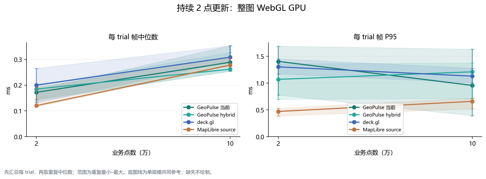

[SVG](figures/primary/continuous-updates-whole-map-gpu.svg)

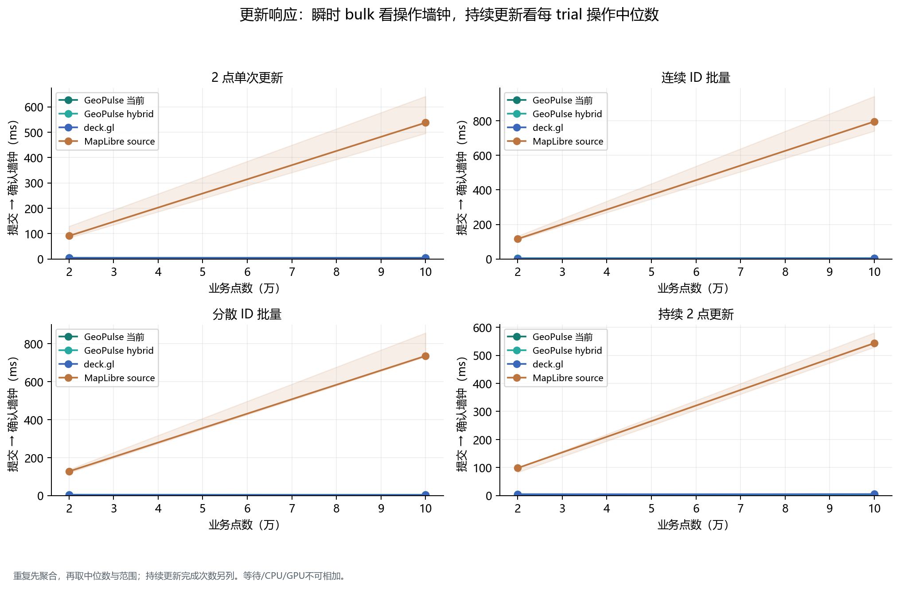

[SVG](figures/primary/update-confirmation-wall.svg)

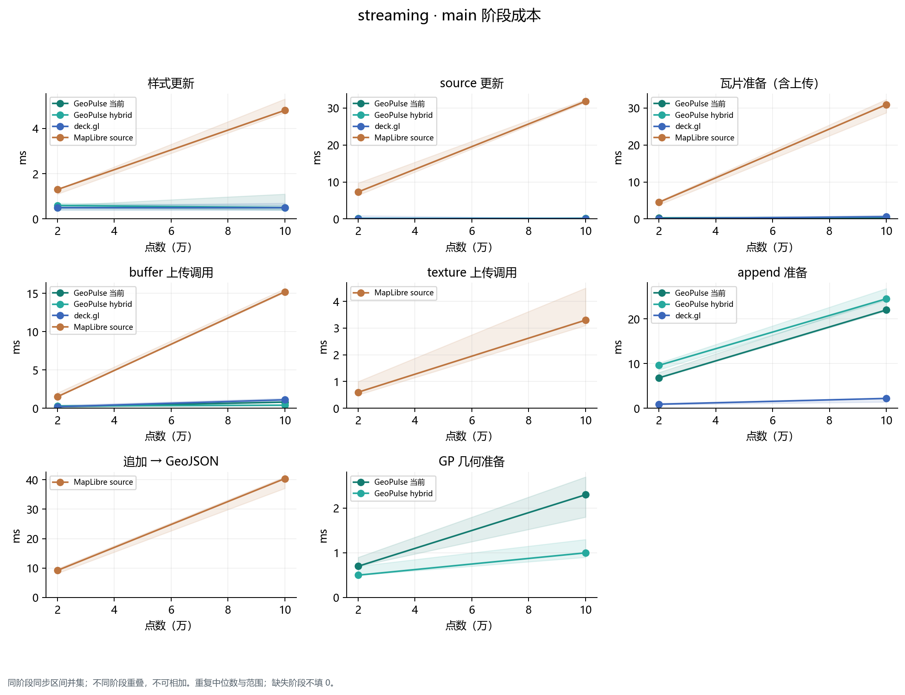

[SVG](figures/primary/phase-streaming-main.svg)

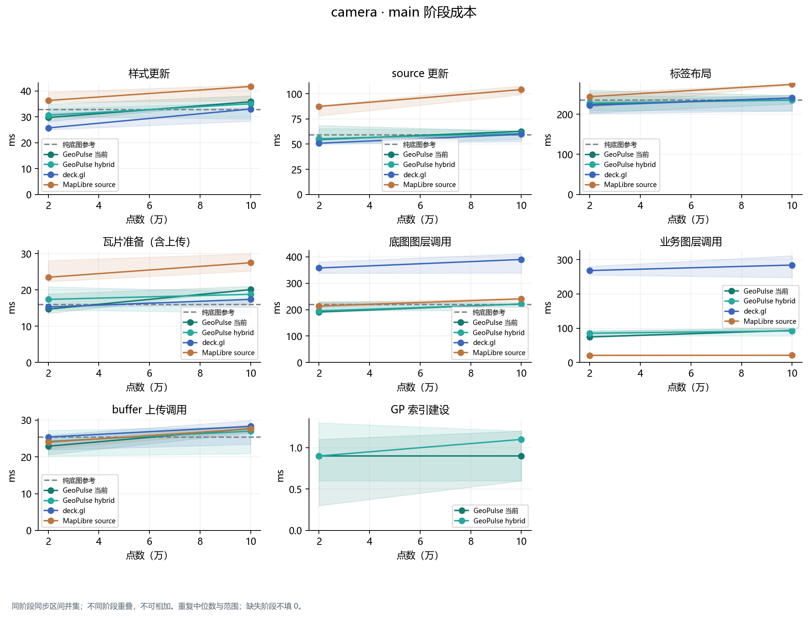

[SVG](figures/primary/phase-camera-main.svg)

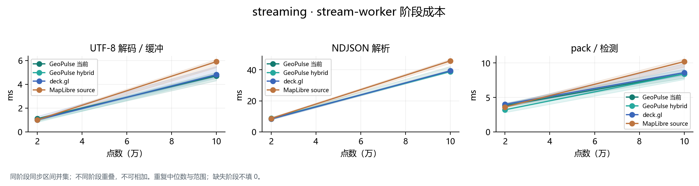

[SVG](figures/primary/phase-streaming-stream-worker.svg)

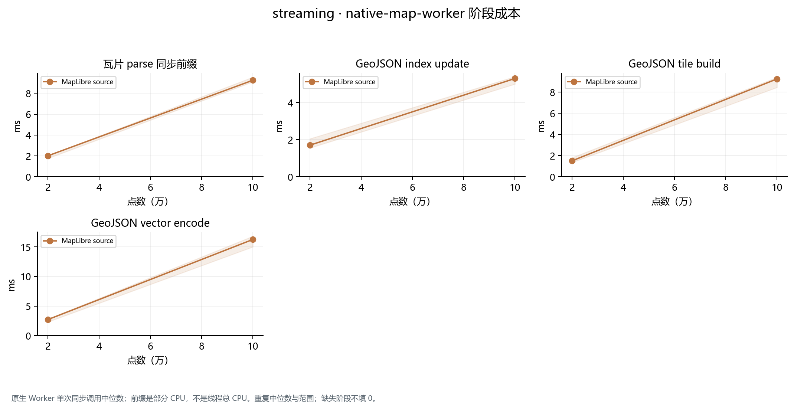

[SVG](figures/primary/phase-streaming-native-map-worker.svg)

聚合：[primary.json](data/primary.json)。来源索引：[source-index.json](source-index.json)。所有缺失值仍为 null；这份文字/JSON是公开衍生副本，原始 SHA 不等于改写文件 SHA。
