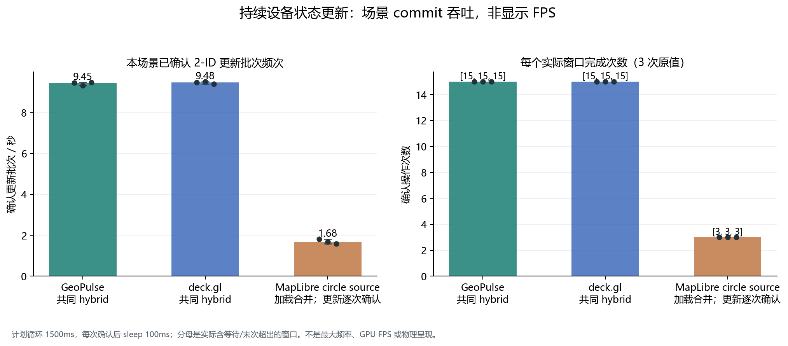

# 已加载整图上的位置更新对照（公开衍生副本）

10 万点加载完成后，三个方案执行相同的 2 ID 与 2048 ID 更新。原生加载阶段使用合并路径，后续每次 update 仍严格等待实际 commit / source idle。GeoPulse / deck 的返回 snapshot 与后续真实 draw revision 对账；没有用 enqueue ACK 代替确认。

| 方案 | 2 点单次 ms | 连续 2048 ID ms | 分散 2048 ID ms | 持续 2 点每次中位数 ms |
| --- | ---: | ---: | ---: | ---: |
| GeoPulse 当前 | 3.70 (3.50–3.80) | 5.10 (4.50–5.20) | 3.50 (3.50–3.80) | 3.70 (3.40–4.70) |
| deck.gl | 4.20 (4.10–5.00) | 3.40 (2.80–3.50) | 3.70 (3.40–3.80) | 4.10 (3.80–5.00) |
| MapLibre source | 504.30 (451.20–525.30) | 848.80 (786.30–864.70) | 886.70 (866.20–912.00) | 491.30 (457.40–507.50) |

数值为先每 trial 汇总、再跨三次取中位数，括号为最小–最大。图采用明确的对数时间轴，使几毫秒和数百毫秒都可读；真实原值与范围保留在 data/updates.json。

| 方案 | 连续确认操作次数（每 trial） | 实际窗口 ms | 本场景确认批次 / 秒 |
| --- | --- | --- | ---: |
| GeoPulse 当前 | [15, 15, 15] | [1586.6, 1606.7, 1582.3] | 9.45 (9.34–9.48) |
| deck.gl | [15, 15, 15] | [1583.1, 1576.1, 1594.5] | 9.48 (9.41–9.52) |
| MapLibre source | [3, 3, 3] | [1648.3, 1786.1, 1885.8] | 1.68 (1.59–1.82) |

循环名义持续 1500ms，每次操作完成后等待 100ms，最后一个操作与等待可能使实际窗口超过计划时间。频次按实际窗口计算，包含该节流与等待；它是此场景中已确认新设备状态的 commit 吞吐，不是产品最大刷新率，更不是浏览器或物理屏幕 FPS。
这里支持的优势集中在已加载后的局部位置更新提交/确认路径；它不证明 GeoPulse 整图 GPU 更快。整图 GPU 在相机窗口另有约 2.5–2.7ms 的相近样本，CPU/GPU、等待与更新次数不能相加或互相换名。
每次 native source 确认还等待源/瓦片 idle，强于只确认上传调用；即使更新材料相同，也不能把本表泛化成所有原生产品的固有更新时延。三次重复与有限 witness/位置核查仍限制普遍结论。

输出：matched-position-update-wall.png/svg、matched-continuous-update-commits.png/svg、data/updates.json。旧 matched1/primary 报告保持原样。生产 renderer 之后因百度默认/自定义样式初始化调整发生字节变化；本图按精确原冻结 renderer SHA 验证，不改旧身份，也不声称新整体源码已在此性能路径复测。

## 可直接查看的原始分析图

[SVG](figures/updates/matched-position-update-wall.svg)

[SVG](figures/updates/matched-continuous-update-commits.svg)

聚合：[updates.json](data/updates.json)。来源索引：[source-index.json](source-index.json)。所有缺失值仍为 null；这份文字/JSON是公开衍生副本，原始 SHA 不等于改写文件 SHA。
