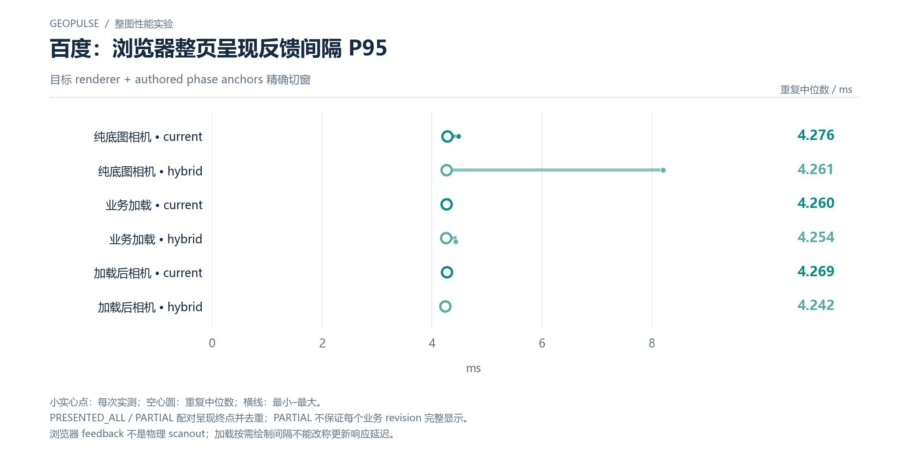

# 百度：浏览器整页呈现反馈间隔 P95

目标 renderer + authored phase anchors 精确切窗

[PNG](../../figures/baidu/browser-compositor-feedback-p95.png) · [SVG](../../figures/baidu/browser-compositor-feedback-p95.svg) · [返回图表目录](../../README.md)

小实心点：每次实测；空心圆：重复中位数；横线：最小–最大。

PRESENTED_ALL / PARTIAL 配对呈现终点并去重；PARTIAL 不保证每个业务 revision 完整显示。

浏览器 feedback 不是物理 scanout；加载按需绘制间隔不能改称更新响应延迟。

数值来自 [2026-10-14 实测报告](../../../whole-map-2026-10-14/README.md)。本图仅重新排版，没有重新运行性能测试；精度、来源指针和三次原值见 [图表清单](../../chart-catalog.json)。
