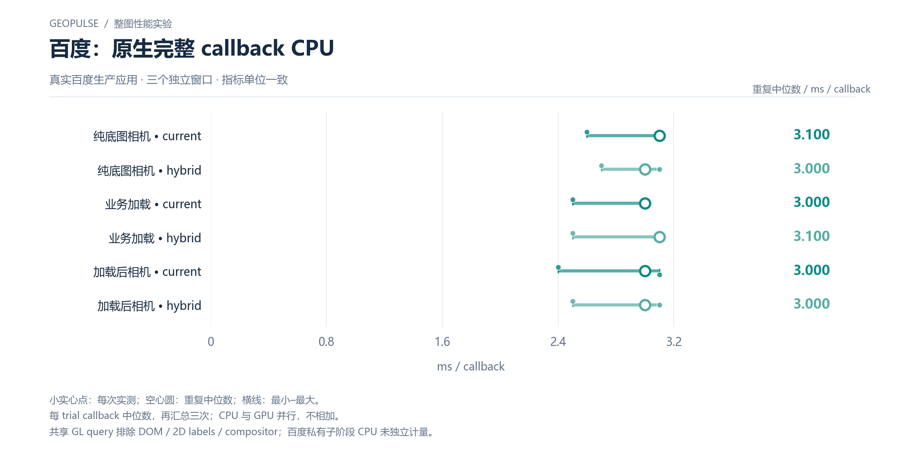

# 百度：原生完整 callback CPU

真实百度生产应用 · 三个独立窗口 · 指标单位一致

[PNG](../../figures/baidu/native-callback-cpu.png) · [SVG](../../figures/baidu/native-callback-cpu.svg) · [返回图表目录](../../README.md)

小实心点：每次实测；空心圆：重复中位数；横线：最小–最大。

每 trial callback 中位数，再汇总三次；CPU 与 GPU 并行，不相加。

共享 GL query 排除 DOM / 2D labels / compositor；百度私有子阶段 CPU 未独立计量。

数值来自 [2026-10-14 实测报告](../../../whole-map-2026-10-14/README.md)。本图仅重新排版，没有重新运行性能测试；精度、来源指针和三次原值见 [图表清单](../../chart-catalog.json)。
