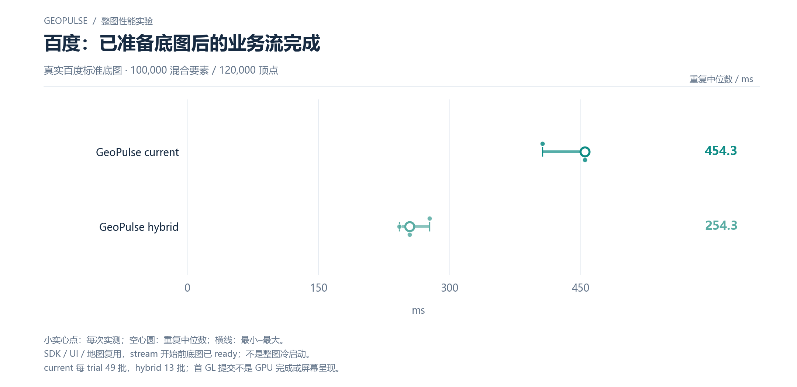

# 百度：已准备底图后的业务流完成

真实百度标准底图 · 100,000 混合要素 / 120,000 顶点

[PNG](../../figures/baidu/ready-basemap-business-stream.png) · [SVG](../../figures/baidu/ready-basemap-business-stream.svg) · [返回图表目录](../../README.md)

小实心点：每次实测；空心圆：重复中位数；横线：最小–最大。

SDK / UI / 地图复用，stream 开始前底图已 ready；不是整图冷启动。

current 每 trial 49 批，hybrid 13 批；首 GL 提交不是 GPU 完成或屏幕呈现。

数值来自 [2026-10-14 实测报告](../../../whole-map-2026-10-14/README.md)。本图仅重新排版，没有重新运行性能测试；精度、来源指针和三次原值见 [图表清单](../../chart-catalog.json)。
