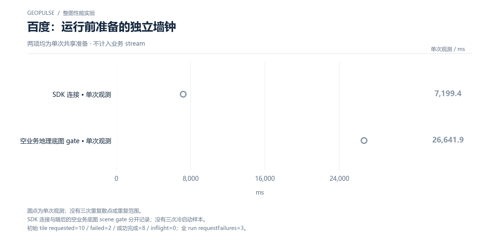

# 百度：运行前准备的独立墙钟

两项均为单次共享准备 · 不计入业务 stream

[PNG](../../figures/baidu/startup-separate-wall.png) · [SVG](../../figures/baidu/startup-separate-wall.svg) · [返回图表目录](../../README.md)

圆点为单次观测；没有三次重复散点或重复范围。

SDK 连接与随后的空业务底图 scene gate 分开记录；没有三次冷启动样本。

初始 tile requested=10 / failed=2 / 成功完成=8 / inflight=0；全 run requestFailures=3。

数值来自 [2026-10-14 实测报告](../../../whole-map-2026-10-14/README.md)。本图仅重新排版，没有重新运行性能测试；精度、来源指针和三次原值见 [图表清单](../../chart-catalog.json)。
