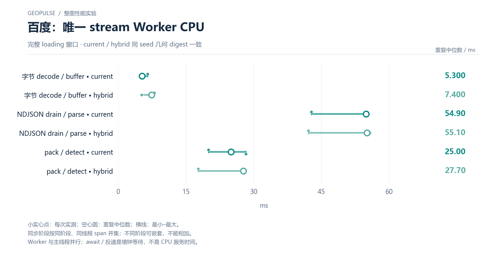

# 百度：唯一 stream Worker CPU

完整 loading 窗口 · current / hybrid 同 seed 几何 digest 一致

[PNG](../../figures/baidu/stream-worker-service.png) · [SVG](../../figures/baidu/stream-worker-service.svg) · [返回图表目录](../../README.md)

小实心点：每次实测；空心圆：重复中位数；横线：最小–最大。

同步阶段按同阶段、同线程 span 并集；不同阶段可嵌套，不能相加。

Worker 与主线程并行；await / 投递是墙钟等待，不是 CPU 服务时间。

数值来自 [2026-10-14 实测报告](../../../whole-map-2026-10-14/README.md)。本图仅重新排版，没有重新运行性能测试；精度、来源指针和三次原值见 [图表清单](../../chart-catalog.json)。
