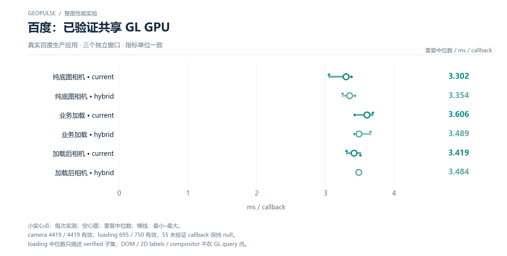

# 百度：已验证共享 GL GPU

真实百度生产应用 · 三个独立窗口 · 指标单位一致

[PNG](../../figures/baidu/verified-shared-gl-gpu.png) · [SVG](../../figures/baidu/verified-shared-gl-gpu.svg) · [返回图表目录](../../README.md)

小实心点：每次实测；空心圆：重复中位数；横线：最小–最大。

camera 4419 / 4419 有效；loading 695 / 750 有效，55 未验证 callback 保持 null。

loading 中位数只描述 verified 子集；DOM / 2D labels / compositor 不在 GL query 内。

数值来自 [2026-10-14 实测报告](../../../whole-map-2026-10-14/README.md)。本图仅重新排版，没有重新运行性能测试；精度、来源指针和三次原值见 [图表清单](../../chart-catalog.json)。
