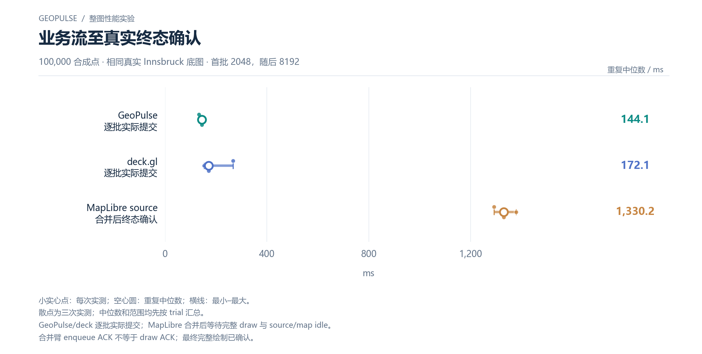

# 业务流至真实终态确认

100,000 合成点 · 相同真实 Innsbruck 底图 · 首批 2048，随后 8192

[PNG](../../figures/matched/business-stream.png) · [SVG](../../figures/matched/business-stream.svg) · [返回图表目录](../../README.md)

小实心点：每次实测；空心圆：重复中位数；横线：最小–最大。

散点为三次实测；中位数和范围均先按 trial 汇总。

GeoPulse/deck 逐批实际提交；MapLibre 合并后等待完整 draw 与 source/map idle。

合并臂 enqueue ACK 不等于 draw ACK；最终完整绘制已确认。

数值来自 [2026-10-14 实测报告](../../../whole-map-2026-10-14/README.md)。本图仅重新排版，没有重新运行性能测试；精度、来源指针和三次原值见 [图表清单](../../chart-catalog.json)。
