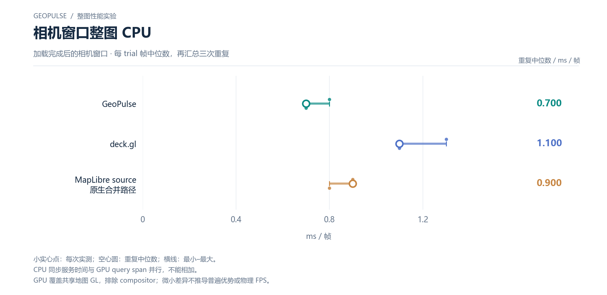

# 相机窗口整图 CPU

加载完成后的相机窗口 · 每 trial 帧中位数，再汇总三次重复

[PNG](../../figures/matched/camera-whole-map-cpu.png) · [SVG](../../figures/matched/camera-whole-map-cpu.svg) · [返回图表目录](../../README.md)

小实心点：每次实测；空心圆：重复中位数；横线：最小–最大。

CPU 同步服务时间与 GPU query span 并行，不能相加。

GPU 覆盖共享地图 GL，排除 compositor；微小差异不推导普遍优势或物理 FPS。

数值来自 [2026-10-14 实测报告](../../../whole-map-2026-10-14/README.md)。本图仅重新排版，没有重新运行性能测试；精度、来源指针和三次原值见 [图表清单](../../chart-catalog.json)。
