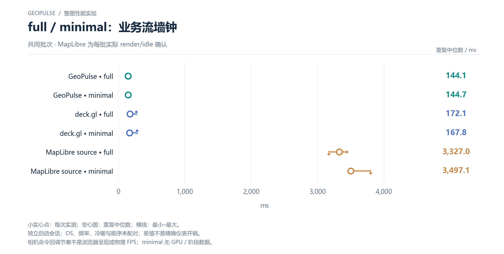

# full / minimal：业务流墙钟

共同批次 · MapLibre 为每批实际 render/idle 确认

[PNG](../../figures/matched/full-minimal-stream.png) · [SVG](../../figures/matched/full-minimal-stream.svg) · [返回图表目录](../../README.md)

小实心点：每次实测；空心圆：重复中位数；横线：最小–最大。

独立启动会话；OS、频率、冷暖与顺序未配对，差值不是精确仪表开销。

相机命令回调节奏不是浏览器呈现或物理 FPS；minimal 无 GPU / 阶段数据。

数值来自 [2026-10-14 实测报告](../../../whole-map-2026-10-14/README.md)。本图仅重新排版，没有重新运行性能测试；精度、来源指针和三次原值见 [图表清单](../../chart-catalog.json)。
