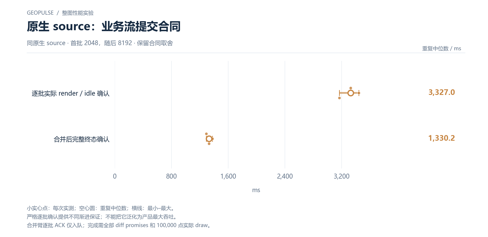

# 原生 source：业务流提交合同

同原生 source · 首批 2048，随后 8192 · 保留合同取舍

[PNG](../../figures/matched/native-contract-stream.png) · [SVG](../../figures/matched/native-contract-stream.svg) · [返回图表目录](../../README.md)

小实心点：每次实测；空心圆：重复中位数；横线：最小–最大。

严格逐批确认提供不同渐进保证；不能把它泛化为产品最大吞吐。

合并臂逐批 ACK 仅入队；完成需全部 diff promises 和 100,000 点实际 draw。

数值来自 [2026-10-14 实测报告](../../../whole-map-2026-10-14/README.md)。本图仅重新排版，没有重新运行性能测试；精度、来源指针和三次原值见 [图表清单](../../chart-catalog.json)。
