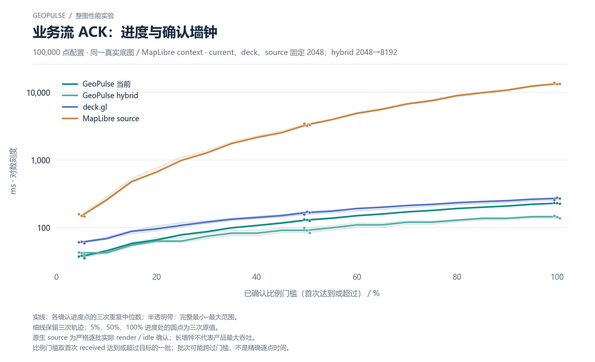

# 业务流 ACK：进度与确认墙钟

100,000 点配置 · 同一真实底图 / MapLibre context · current、deck、source 固定 2048；hybrid 2048→8192

[PNG](../../figures/primary/ack-business-stream-100000.png) · [SVG](../../figures/primary/ack-business-stream-100000.svg) · [返回图表目录](../../README.md)

实线：各确认进度点的三次重复中位数；半透明带：完整最小–最大范围。

细线保留三次轨迹；5%、50%、100% 进度处的圆点为三次原值。

原生 source 为严格逐批实际 render / idle 确认；长墙钟不代表产品最大吞吐。

比例门槛取首次 received 达到或超过目标的一批；批次可能跨过门槛，不是精确逐点时间。

数值来自 [2026-10-14 实测报告](../../../whole-map-2026-10-14/README.md)。本图仅重新排版，没有重新运行性能测试；精度、来源指针和三次原值见 [图表清单](../../chart-catalog.json)。
