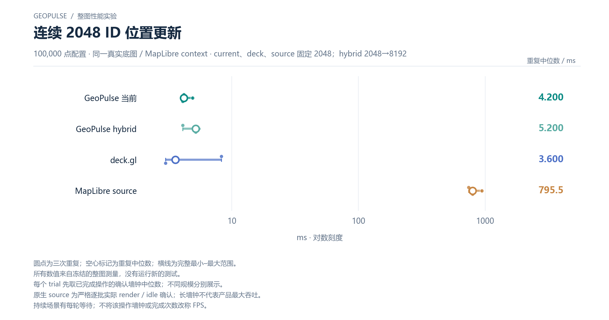

# 连续 2048 ID 位置更新

100,000 点配置 · 同一真实底图 / MapLibre context · current、deck、source 固定 2048；hybrid 2048→8192

[PNG](../../figures/primary/bulk-contiguous-confirmation-100000.png) · [SVG](../../figures/primary/bulk-contiguous-confirmation-100000.svg) · [返回图表目录](../../README.md)

圆点为三次重复；空心标记为重复中位数；横线为完整最小–最大范围。

所有数值来自冻结的整图测量，没有运行新的测试。

每个 trial 先取已完成操作的确认墙钟中位数；不同规模分别展示。

原生 source 为严格逐批实际 render / idle 确认；长墙钟不代表产品最大吞吐。

持续场景有每轮等待；不将该操作墙钟或完成次数改称 FPS。

数值来自 [2026-10-14 实测报告](../../../whole-map-2026-10-14/README.md)。本图仅重新排版，没有重新运行性能测试；精度、来源指针和三次原值见 [图表清单](../../chart-catalog.json)。
