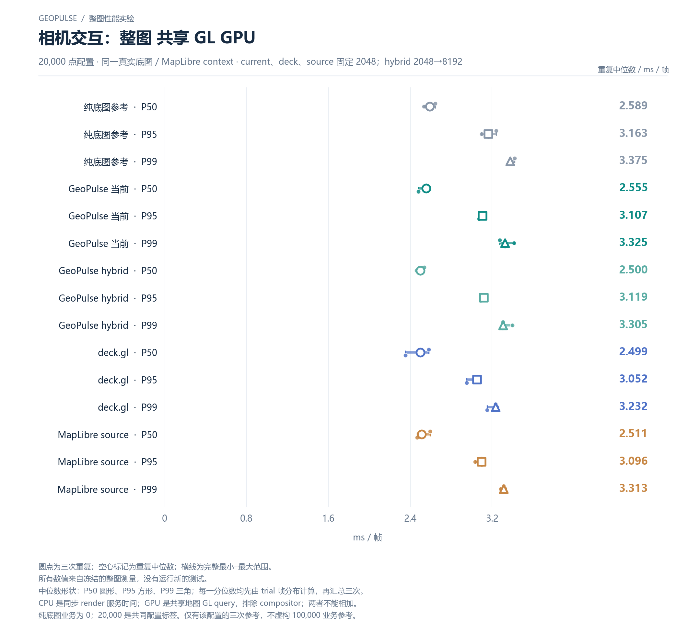

# 相机交互：整图 共享 GL GPU

20,000 点配置 · 同一真实底图 / MapLibre context · current、deck、source 固定 2048；hybrid 2048→8192

[PNG](../../figures/primary/camera-gpu-quantiles-20000.png) · [SVG](../../figures/primary/camera-gpu-quantiles-20000.svg) · [返回图表目录](../../README.md)

圆点为三次重复；空心标记为重复中位数；横线为完整最小–最大范围。

所有数值来自冻结的整图测量，没有运行新的测试。

中位数形状：P50 圆形、P95 方形、P99 三角；每一分位数均先由 trial 帧分布计算，再汇总三次。

CPU 是同步 render 服务时间；GPU 是共享地图 GL query，排除 compositor；两者不能相加。

纯底图业务为 0；20,000 是共同配置标签。仅有该配置的三次参考，不虚构 100,000 业务参考。

数值来自 [2026-10-14 实测报告](../../../whole-map-2026-10-14/README.md)。本图仅重新排版，没有重新运行性能测试；精度、来源指针和三次原值见 [图表清单](../../chart-catalog.json)。
