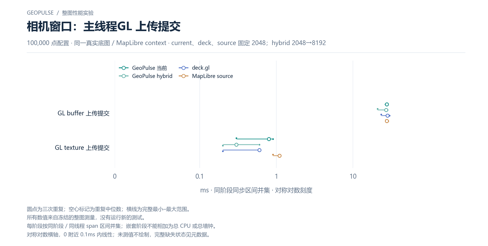

# 相机窗口：主线程GL 上传提交

100,000 点配置 · 同一真实底图 / MapLibre context · current、deck、source 固定 2048；hybrid 2048→8192

[PNG](../../figures/primary/camera-main-uploads-100000.png) · [SVG](../../figures/primary/camera-main-uploads-100000.svg) · [返回图表目录](../../README.md)

圆点为三次重复；空心标记为重复中位数；横线为完整最小–最大范围。

所有数值来自冻结的整图测量，没有运行新的测试。

每阶段按同阶段 / 同线程 span 区间并集；嵌套阶段不能相加为总 CPU 或总墙钟。

对称对数横轴，0 附近 0.1ms 内线性；未测值不绘制，完整缺失状态见元数据。

数值来自 [2026-10-14 实测报告](../../../whole-map-2026-10-14/README.md)。本图仅重新排版，没有重新运行性能测试；精度、来源指针和三次原值见 [图表清单](../../chart-catalog.json)。
