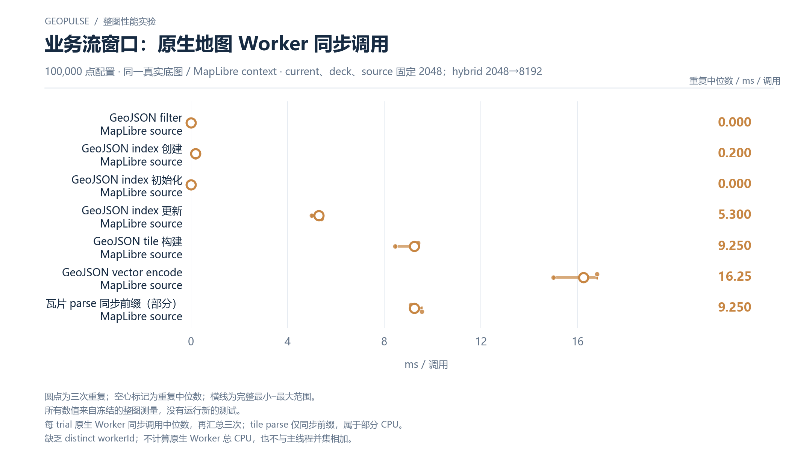

# 业务流窗口：原生地图 Worker 同步调用

100,000 点配置 · 同一真实底图 / MapLibre context · current、deck、source 固定 2048；hybrid 2048→8192

[PNG](../../figures/primary/streaming-native-map-worker-100000.png) · [SVG](../../figures/primary/streaming-native-map-worker-100000.svg) · [返回图表目录](../../README.md)

圆点为三次重复；空心标记为重复中位数；横线为完整最小–最大范围。

所有数值来自冻结的整图测量，没有运行新的测试。

每 trial 原生 Worker 同步调用中位数，再汇总三次；tile parse 仅同步前缀，属于部分 CPU。

缺乏 distinct workerId；不计算原生 Worker 总 CPU，也不与主线程并集相加。

数值来自 [2026-10-14 实测报告](../../../whole-map-2026-10-14/README.md)。本图仅重新排版，没有重新运行性能测试；精度、来源指针和三次原值见 [图表清单](../../chart-catalog.json)。
