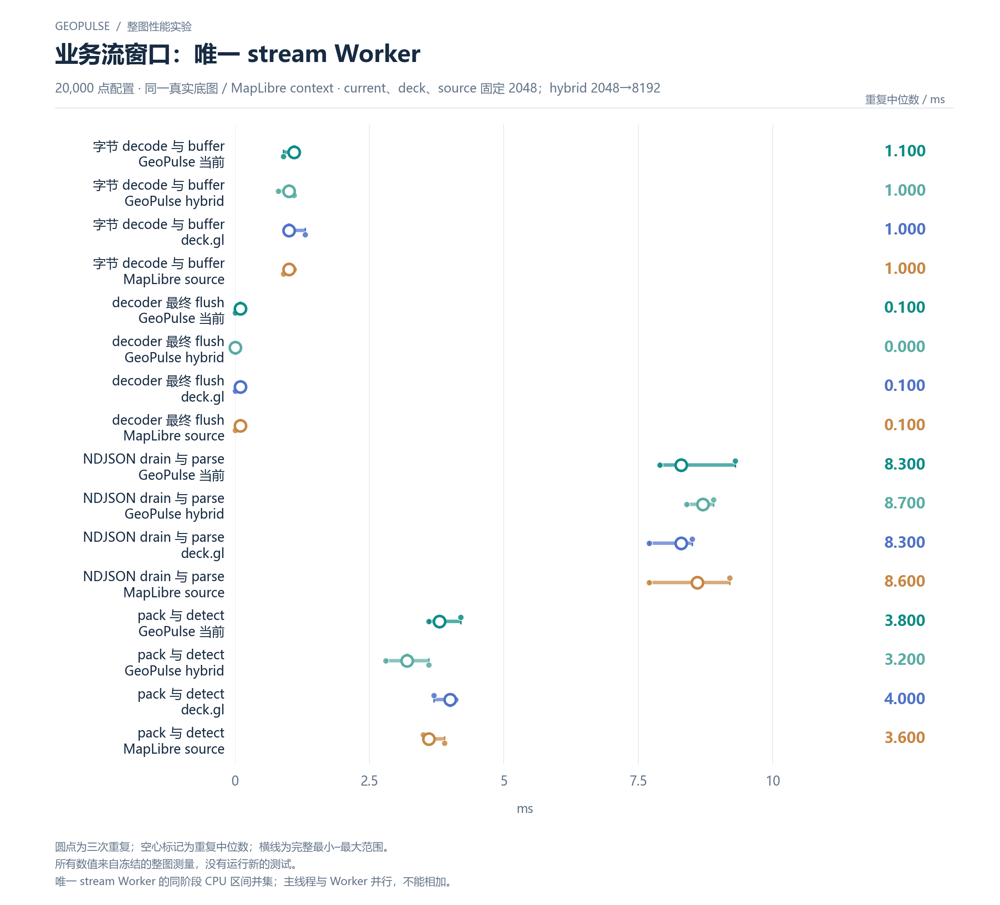

# 业务流窗口：唯一 stream Worker

20,000 点配置 · 同一真实底图 / MapLibre context · current、deck、source 固定 2048；hybrid 2048→8192

[PNG](../../figures/primary/streaming-stream-worker-20000.png) · [SVG](../../figures/primary/streaming-stream-worker-20000.svg) · [返回图表目录](../../README.md)

圆点为三次重复；空心标记为重复中位数；横线为完整最小–最大范围。

所有数值来自冻结的整图测量，没有运行新的测试。

唯一 stream Worker 的同阶段 CPU 区间并集；主线程与 Worker 并行，不能相加。

数值来自 [2026-10-14 实测报告](../../../whole-map-2026-10-14/README.md)。本图仅重新排版，没有重新运行性能测试；精度、来源指针和三次原值见 [图表清单](../../chart-catalog.json)。
