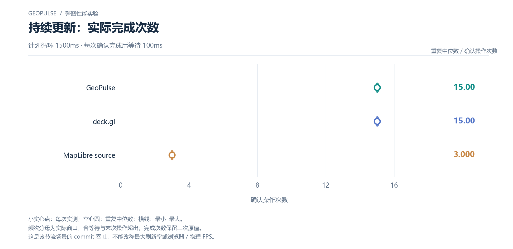

# 持续更新：实际完成次数

计划循环 1500ms · 每次确认完成后等待 100ms

[PNG](../../figures/updates/continuous-confirmed-count.png) · [SVG](../../figures/updates/continuous-confirmed-count.svg) · [返回图表目录](../../README.md)

小实心点：每次实测；空心圆：重复中位数；横线：最小–最大。

频次分母为实际窗口，含等待与末次操作超出；完成次数保留三次原值。

这是该节流场景的 commit 吞吐，不能改称最大刷新率或浏览器 / 物理 FPS。

数值来自 [2026-10-14 实测报告](../../../whole-map-2026-10-14/README.md)。本图仅重新排版，没有重新运行性能测试；精度、来源指针和三次原值见 [图表清单](../../chart-catalog.json)。
