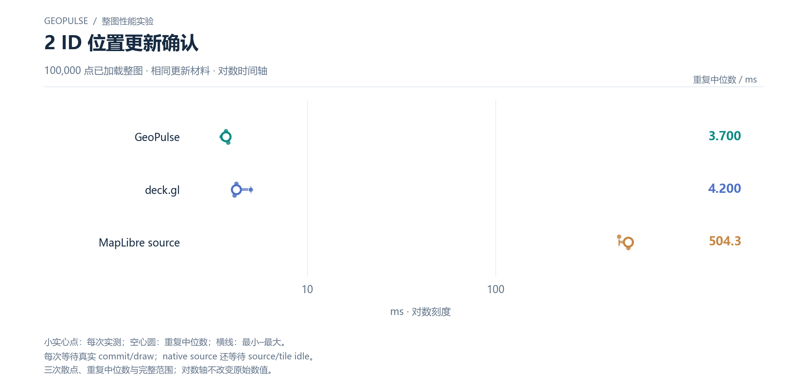

# 2 ID 位置更新确认

100,000 点已加载整图 · 相同更新材料 · 对数时间轴

[PNG](../../figures/updates/two-point-update-wall.png) · [SVG](../../figures/updates/two-point-update-wall.svg) · [返回图表目录](../../README.md)

小实心点：每次实测；空心圆：重复中位数；横线：最小–最大。

每次等待真实 commit/draw；native source 还等待 source/tile idle。

三次散点、重复中位数与完整范围；对数轴不改变原始数值。

数值来自 [2026-10-14 实测报告](../../../whole-map-2026-10-14/README.md)。本图仅重新排版，没有重新运行性能测试；精度、来源指针和三次原值见 [图表清单](../../chart-catalog.json)。
